<!--
  Generated by `python -m generator.readme` from profile.yml. Do not edit by hand.
  Every image is re-rendered nightly by .github/workflows/profile.yml and served from the `output` branch.
-->

<picture><source media="(prefers-color-scheme: dark)" srcset="https://raw.githubusercontent.com/danilkberlin/danilkberlin/output/hero-dark.svg"><source media="(prefers-color-scheme: light)" srcset="https://raw.githubusercontent.com/danilkberlin/danilkberlin/output/hero-light.svg"></picture>

<a href="https://github.com/danilkberlin"><picture><source media="(prefers-color-scheme: dark)" srcset="https://raw.githubusercontent.com/danilkberlin/danilkberlin/output/btn-github-dark.svg"><source media="(prefers-color-scheme: light)" srcset="https://raw.githubusercontent.com/danilkberlin/danilkberlin/output/btn-github-light.svg"></picture></a>
<a href="https://www.linkedin.com/in/danylo-kravets-b29233380"><picture><source media="(prefers-color-scheme: dark)" srcset="https://raw.githubusercontent.com/danilkberlin/danilkberlin/output/btn-linkedin-dark.svg"><source media="(prefers-color-scheme: light)" srcset="https://raw.githubusercontent.com/danilkberlin/danilkberlin/output/btn-linkedin-light.svg"></picture></a>
<a href="https://t.me/danilkravets"><picture><source media="(prefers-color-scheme: dark)" srcset="https://raw.githubusercontent.com/danilkberlin/danilkberlin/output/btn-telegram-dark.svg"><source media="(prefers-color-scheme: light)" srcset="https://raw.githubusercontent.com/danilkberlin/danilkberlin/output/btn-telegram-light.svg"></picture></a>
<a href="https://danilkberlin.github.io/danylo-kravets/"><picture><source media="(prefers-color-scheme: dark)" srcset="https://raw.githubusercontent.com/danilkberlin/danilkberlin/output/btn-portfolio-dark.svg"><source media="(prefers-color-scheme: light)" srcset="https://raw.githubusercontent.com/danilkberlin/danilkberlin/output/btn-portfolio-light.svg"></picture></a>

<picture><source media="(prefers-color-scheme: dark)" srcset="https://raw.githubusercontent.com/danilkberlin/danilkberlin/output/about-dark.svg"><source media="(prefers-color-scheme: light)" srcset="https://raw.githubusercontent.com/danilkberlin/danilkberlin/output/about-light.svg"></picture>

<picture><source media="(prefers-color-scheme: dark)" srcset="https://raw.githubusercontent.com/danilkberlin/danilkberlin/output/stats-dark.svg"><source media="(prefers-color-scheme: light)" srcset="https://raw.githubusercontent.com/danilkberlin/danilkberlin/output/stats-light.svg"></picture>

<picture><source media="(prefers-color-scheme: dark)" srcset="https://raw.githubusercontent.com/danilkberlin/danilkberlin/output/city-dark.gif"><source media="(prefers-color-scheme: light)" srcset="https://raw.githubusercontent.com/danilkberlin/danilkberlin/output/city-light.gif">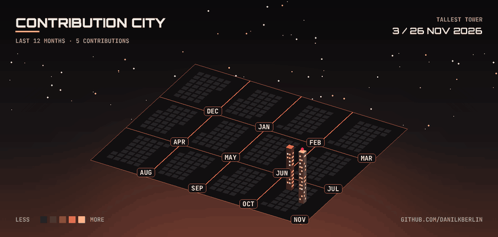</picture>

<picture><source media="(prefers-color-scheme: dark)" srcset="https://raw.githubusercontent.com/danilkberlin/danilkberlin/output/calendar-dark.svg"><source media="(prefers-color-scheme: light)" srcset="https://raw.githubusercontent.com/danilkberlin/danilkberlin/output/calendar-light.svg"></picture>

<picture><source media="(prefers-color-scheme: dark)" srcset="https://raw.githubusercontent.com/danilkberlin/danilkberlin/output/pulse-dark.svg"><source media="(prefers-color-scheme: light)" srcset="https://raw.githubusercontent.com/danilkberlin/danilkberlin/output/pulse-light.svg"></picture>

<picture><source media="(prefers-color-scheme: dark)" srcset="https://raw.githubusercontent.com/danilkberlin/danilkberlin/output/languages-dark.svg"><source media="(prefers-color-scheme: light)" srcset="https://raw.githubusercontent.com/danilkberlin/danilkberlin/output/languages-light.svg"></picture>
<picture><source media="(prefers-color-scheme: dark)" srcset="https://raw.githubusercontent.com/danilkberlin/danilkberlin/output/clock-dark.svg"><source media="(prefers-color-scheme: light)" srcset="https://raw.githubusercontent.com/danilkberlin/danilkberlin/output/clock-light.svg"></picture>

<picture><source media="(prefers-color-scheme: dark)" srcset="https://raw.githubusercontent.com/danilkberlin/danilkberlin/output/departures-dark.svg"><source media="(prefers-color-scheme: light)" srcset="https://raw.githubusercontent.com/danilkberlin/danilkberlin/output/departures-light.svg"></picture>

<a href="https://github.com/danilkberlin/danylo-kravets"><picture><source media="(prefers-color-scheme: dark)" srcset="https://raw.githubusercontent.com/danilkberlin/danilkberlin/output/project-danylo-kravets-dark.svg"><source media="(prefers-color-scheme: light)" srcset="https://raw.githubusercontent.com/danilkberlin/danilkberlin/output/project-danylo-kravets-light.svg"></picture></a>
<a href="https://github.com/danilkberlin/monopoly"><picture><source media="(prefers-color-scheme: dark)" srcset="https://raw.githubusercontent.com/danilkberlin/danilkberlin/output/project-monopoly-dark.svg"><source media="(prefers-color-scheme: light)" srcset="https://raw.githubusercontent.com/danilkberlin/danilkberlin/output/project-monopoly-light.svg"></picture></a>
<a href="https://github.com/danilkberlin/dolphin"><picture><source media="(prefers-color-scheme: dark)" srcset="https://raw.githubusercontent.com/danilkberlin/danilkberlin/output/project-dolphin-dark.svg"><source media="(prefers-color-scheme: light)" srcset="https://raw.githubusercontent.com/danilkberlin/danilkberlin/output/project-dolphin-light.svg"></picture></a>

<picture><source media="(prefers-color-scheme: dark)" srcset="https://raw.githubusercontent.com/danilkberlin/danilkberlin/output/stack-dark.svg"><source media="(prefers-color-scheme: light)" srcset="https://raw.githubusercontent.com/danilkberlin/danilkberlin/output/stack-light.svg"></picture>

<picture><source media="(prefers-color-scheme: dark)" srcset="https://raw.githubusercontent.com/danilkberlin/danilkberlin/output/achievements-dark.svg"><source media="(prefers-color-scheme: light)" srcset="https://raw.githubusercontent.com/danilkberlin/danilkberlin/output/achievements-light.svg"></picture>

<picture><source media="(prefers-color-scheme: dark)" srcset="https://raw.githubusercontent.com/danilkberlin/danilkberlin/output/nightly-dark.svg"><source media="(prefers-color-scheme: light)" srcset="https://raw.githubusercontent.com/danilkberlin/danilkberlin/output/nightly-light.svg"></picture>
<picture><source media="(prefers-color-scheme: dark)" srcset="https://raw.githubusercontent.com/danilkberlin/danilkberlin/output/quote-dark.svg"><source media="(prefers-color-scheme: light)" srcset="https://raw.githubusercontent.com/danilkberlin/danilkberlin/output/quote-light.svg"></picture>

<a href="https://github.com/danilkberlin#danilkberlin"><picture><source media="(prefers-color-scheme: dark)" srcset="https://raw.githubusercontent.com/danilkberlin/danilkberlin/output/footer-dark.svg"><source media="(prefers-color-scheme: light)" srcset="https://raw.githubusercontent.com/danilkberlin/danilkberlin/output/footer-light.svg"></picture></a>

